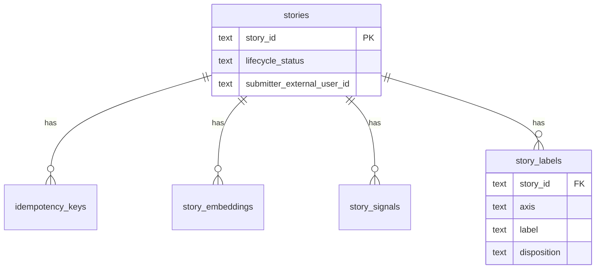
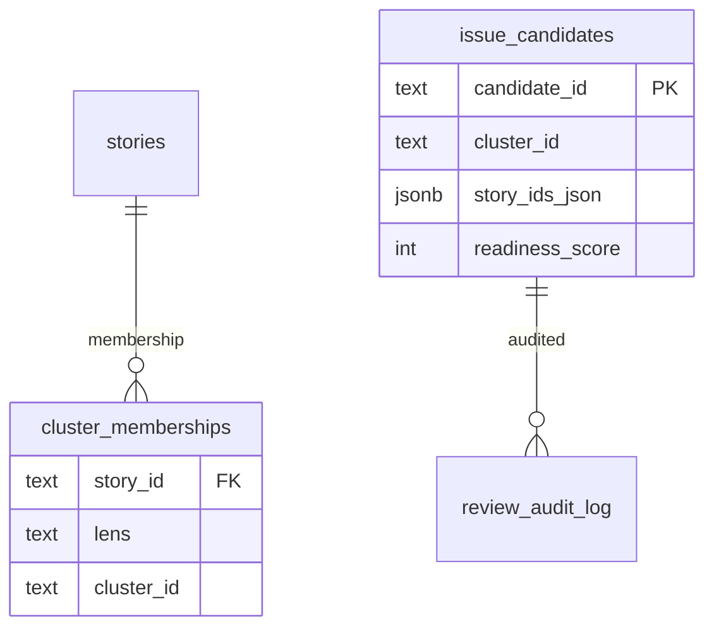
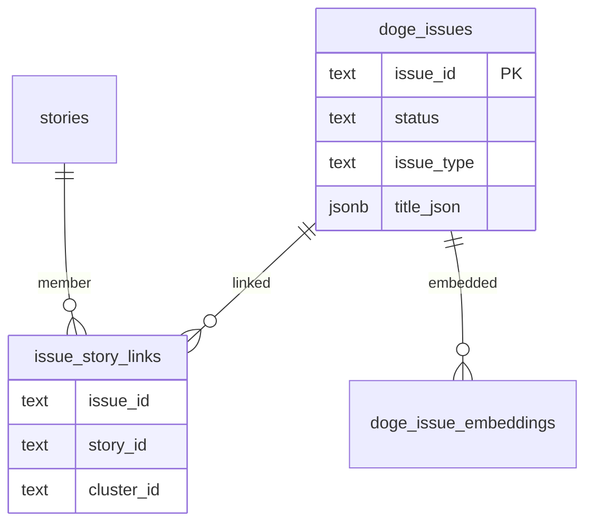

# Story Persistence Model — Supabase

**Дата:** 2026-07-21 (обновлено: 2026-08-29T09:20:52Z — SSR-02 binding-колонки `stories`)  
**Источники:** `supabase/bootstrap/000_full_init.sql`, `src/core/infrastructure/db_supabase.py`, `src/core/infrastructure/db_sqlite.py`, `src/core/domain/contracts.py`, `src/core/application/services.py`

Документ — операционная схема таблиц gateway: группы связанных таблиц (mermaid) + колонки + зачем связь существует. Claims только из bootstrap/кода.

---

## Карта групп (быстрая валидация)

| Группа | Таблицы | Роль |
|--------|---------|------|
| A. Intake handoff | `story_drafts`, `draft_owner` | GPT stash → browser; владелец появляется позже |
| B. Story core | `stories`, `idempotency_keys`, `story_embeddings`, `story_signals`, `story_labels` | Принятая история и её производные |
| C. Clustering / promotion | `cluster_memberships`, `issue_candidates`, `review_audit_log` | Группировка → кандидат → audit |
| D. Published board | `issue_story_links`, `doge_issues`, `doge_issue_embeddings`, view `issues_dashboard` | Карточки на доске |

RLS: таблицы — `service_role` only. View `issues_dashboard` — select для `anon` / `authenticated`.

---

## Группа A — Intake handoff (черновик без истории)

Черновик **не** является строкой в `stories`. GPT кладёт JSON; браузер забирает по opaque `draft_id`; владелец фиксируется при **первом** авторизованном чтении (first-wins).

```mermaid
erDiagram
  story_drafts ||--o| draft_owner : "owned_after_first_read"
  story_drafts {
    text draft_id PK
    jsonb payload_json
    timestamptz created_at
    timestamptz expires_at
    timestamptz updated_at
  }
  draft_owner {
    text draft_id PK_FK
    text submitter_external_user_id
    timestamptz created_at
  }
```

### `public.story_drafts` (GW-DRAFT-01 + `updated_at` из GW-CAB-02)

| Колонка | Тип | Описание |
|---------|-----|----------|
| `draft_id` | `text PK` | Opaque id (`secrets.token_urlsafe(16)`) |
| `payload_json` | `jsonb NOT NULL` | Полный stash JSON (без submitter на момент GPT) |
| `created_at` | `timestamptz NOT NULL` | UTC момент стеша |
| `expires_at` | `timestamptz NOT NULL` | `created_at + STORY_DRAFT_TTL_SECONDS` |
| `updated_at` | `timestamptz NOT NULL` | Init = `created_at`; для кабинетного «свежести» |

**TTL:** `get_draft()` → `None` (HTTP 404), когда `expires_at <= now()`.

**Порт:** `StoryDraftRepository` — [`contracts.py`](../../src/core/domain/contracts.py).

### `public.draft_owner` (GW-CAB-02)

| Колонка | Тип | Описание |
|---------|-----|----------|
| `draft_id` | `text PK` | FK → `story_drafts` ON DELETE CASCADE |
| `submitter_external_user_id` | `text NOT NULL` | Владелец из `/me` (browser Bearer) |
| `created_at` | `timestamptz NOT NULL` | Момент ассоциации |

**Индекс:** `idx_draft_owner_submitter` — lookup для `GET /story-drafts/current`.

**Порт:** `DraftOwnerRepository.set_owner` / `get_current_draft` — join `draft_owner × story_drafts`, TTL + `ORDER BY created_at DESC` ([`db_sqlite.py`](../../src/core/infrastructure/db_sqlite.py)).

### FAQ: почему не колонки в `story_drafts`?

Связь формально 1:0..1, но **жизненный цикл разный**:

1. GPT создаёт draft **без** user id (`StoryDraftRecord` не содержит submitter).
2. Владелец пишется на read: `set_owner` с **first-wins** (`INSERT … ON CONFLICT DO NOTHING` / `setdefault` / `ignore-duplicates`) — не UPDATE payload-строки.
3. Отдельный порт `DraftOwnerRepository` отражает «ассоциация после stash», не поля черновика.

Nullable `submitter_*` на `story_drafts` технически возможны; текущий код и миграции держат отдельную таблицу — bootstrap следует им.

**Миграции:** `20260703_1200_gw_draft_01_story_drafts.sql`, `20260714_1000_gw_cab_02_draft_owner_and_updated_at.sql`.

---

## Группа B — Story core



### Обзор связей с историей

```
stories                     ← основная запись intake
  ├── idempotency_keys      ← dedup: intake_key → story_id
  ├── story_embeddings      ← векторный fingerprint
  ├── story_signals         ← кэш extraction_policy → signals_json
  └── story_labels          ← per-axis taxonomy (GW-TAX-01); 1:N строк

(отдельный контур, не FK на stories:)
story_drafts ──o| draft_owner   ← handoff GPT→browser (группа A)
```

---

## Слой 1: `public.stories` — основная запись истории

### Идентификация

| Колонка | Тип | Обязательно | Описание |
|---------|-----|-------------|---------|
| `story_id` | `text PK` | да | UUID4, генерируется сервером при intake |
| `schema_version` | `text NOT NULL` | да | Версия схемы входящего запроса (`m2.story_intake_envelope.v2`) |
| `lifecycle_status` | `text NOT NULL` | да | Текущее состояние в pipeline (см. ниже) |
| `created_at` | `timestamptz NOT NULL` | да | UTC, момент создания записи |
| `updated_at` | `timestamptz NOT NULL` | да | UTC, обновляется при каждом `save_story()` и `update_lifecycle_status()` |

**`lifecycle_status` — допустимые значения:**

| Значение | Условие перехода |
|----------|-----------------|
| `accepted` | Создана, но `narrative_v2_complete()` = False |
| `partial_ready` | `narrative_v2_complete()` = False (все обязательные поля заполнены?) |
| `ready_for_profile` | `narrative_v2_complete()` = True — история попадает в очередь кластеризации |
| `clustered` | Кластер промотирован в issue — история помечена как обработанная (идемпотентность cron) |

Переход выполняется в `services.py:advance_story_readiness()` сразу после `save_story()`.

Source: `domain/contracts.py:20-25`, `services.py:281-338`

---

### Schema pack binding (SSR-02, nullable)

Шесть колонок на **существующей** `stories` (`ALTER … ADD COLUMN IF NOT EXISTS`). Civic строки без `schema_binding` остаются `NULL`. Колонка `schema_version` выше — **envelope** `m2.story_intake_envelope.v2`, не версия пака.

| Колонка | Тип | Обязательно | Описание |
|---------|-----|-------------|---------|
| `schema_id` | `text` | нет | id пака (`legal_process`, …) |
| `bound_schema_version` | `text` | нет | версия пака (напр. `v1`); **не** путать с envelope `schema_version` |
| `profile_id` | `text` | нет | optional profile |
| `profile_version` | `text` | нет | optional |
| `structured_payload` | `jsonb` | нет | канонический JSON пака; pack clustering читает **только** это поле |
| `payload_hash` | `text` | нет | SHA-256 канонического JSON; считает сервер, не клиент |

DDL: [`supabase/migrations/20260828_1400_gw_ssr_02_stories_schema_binding.sql`](../../supabase/migrations/20260828_1400_gw_ssr_02_stories_schema_binding.sql); тот же ALTER в [`000_full_init.sql`](../../supabase/bootstrap/000_full_init.sql). SQLite: `_ensure_sqlite_schema_migrations` в [`db_sqlite.py`](../../src/core/infrastructure/db_sqlite.py) (`schema_id` … `payload_hash`). Domain: [`StoryRecord`](../../src/core/domain/contracts.py) `:68–74`.

Hosted: пока колонок нет, omit-probe в [`db_supabase.py`](../../src/core/infrastructure/db_supabase.py) вырезает `_STORIES_BINDING_COLUMNS` из SELECT/save. **Не** класть эти имена в `required_columns_ready`. Операторский мануал: [`manuals/schema-packs-node-data-model-ru.md`](./manuals/schema-packs-node-data-model-ru.md).

---

### Нарратив

| Колонка | Тип | Обязательно | Описание |
|---------|-----|-------------|---------|
| `narrative_original_text` | `text NOT NULL` | да | Оригинальный текст истории от пользователя (stripped) |
| `narrative_language` | `text` | нет | Язык `original_text`: `et`, `ru`, `en` |
| `narrative_session_language` | `text` | нет | Язык интерфейса сессии (может отличаться от `language`) |
| `narrative_title_json` | `jsonb` | нет | Многоязычный заголовок: `{"et": "...", "ru": "...", "en": "..."}` |
| `narrative_description_json` | `jsonb` | нет | Многоязычное описание: `{"et": "...", "ru": "...", "en": "..."}` |
| `narrative_summary_json` | `text` (JSON) | нет | Многоязычное резюме (опционально, тот же формат dict) |
| `institution_json` | `jsonb` | нет | Многоязычное ведомство из `narrative.institution` (REQ-43): `{"et": "...", "ru": "...", "en": "..."}` |
| `narrative_consistency_notes` | `text` | нет | Заметки о согласованности нарратива из `live_story_context.consistency_notes` |
| `narrative_canonical_type` | `text` | нет | Тип из GPT: `complaint`, `observation`, `system_bug`, `absurdity` (без enum-валидации при intake) |
| `narrative_canonical_labels_json` | `text NOT NULL default '[]'` | да | JSON-массив строк: canonical labels из GPT, нормализованные (`.strip().lower()`, deduped) — legacy flat; per-axis → `story_labels` |

**Легаси `narrative_title_hint*` (REQ-46 §2.4, STORY-M2-02-12 T11–T13):** колонки удалены из bootstrap и persistence; hosted purge — `supabase/migrations/20260603_1200_req46_title_hint_test_purge_and_column_drop.sql`. Чтение/запись title — только через `narrative_title_json`.

---

### Submitter / идентификация пользователя

| Колонка | Тип | Обязательно | Описание |
|---------|-----|-------------|---------|
| `submitter_external_user_id` | `text NOT NULL` | да | Внешний ID пользователя (напр. `telegram:123456789`) |
| `submitter_identity_issuer` | `text NOT NULL` | да | Источник идентификатора (напр. `telegram`) |

---

### Origin / источник запроса

| Колонка | Тип | Описание |
|---------|-----|---------|
| `origin_source` | `text` | Наименование источника (напр. `telegram_bot`) |
| `origin_conversation_id` | `text` | ID разговора в системе-источнике |
| `origin_tool_call_id` | `text` | ID tool call (при интеграции с GPT function calling) |

---

### Privacy

| Колонка | Тип | Default | Описание |
|---------|-----|---------|---------|
| `privacy_contains_pii` | `boolean NOT NULL` | `false` | Флаг наличия персональных данных. Если `true` — `original_text` редактируется в логах |
| `privacy_redaction_requested` | `boolean NOT NULL` | `false` | Запрос на удаление данных пользователем |

---

### Geo — нормализованная гео-позиция

Заполняется сервисом `geo_service.resolve_for_story(location_query)` при intake, если `location_query` не пустой и `GEO_SERVICE_ENABLED=true`. Если geo не разрешён — все поля `NULL`.

| Колонка | Тип | Описание |
|---------|-----|---------|
| `geo_normalized_label` | `text` | Нормализованный адресный label от geo-провайдера |
| `geo_latitude` | `double precision` | Широта |
| `geo_longitude` | `double precision` | Долгота |
| `geo_confidence` | `double precision` | Уверенность geo-провайдера (0.0–1.0) |
| `geo_provider` | `text` | Провайдер, разрешивший адрес |
| `geo_cluster_tags_json` | `text NOT NULL default '[]'` | JSON-массив тегов кластеризации от провайдера |
| `geo_admin_district` | `text` | Административный район (напр. `Kesklinn`) |
| `geo_admin_settlement` | `text` | Населённый пункт (напр. `tallinn`) |
| `geo_admin_region` | `text` | Регион (напр. `harju`) |
| `geo_admin_country` | `text` | Страна (напр. `ee`) |

Geo-поля используются в:
- `CLUSTER_GEO_FILTER` — суффикс cluster_key (`geo:{level}:{token}`)
- `CLUSTER_GEO_SCOPE` — gate при intake (reject если вне scope)
- `GET /node/issues?geo_district=...` — фильтрация в read API через `payload_json`

Source: `domain/contracts.py:27-42`, `db_supabase.py:96-122`

---

## Слой 1b: `public.story_labels` — per-axis taxonomy (GW-TAX-01)

Каждая строка = одна метка на одной оси с disposition. Не заменяет flat `narrative_canonical_labels_json` (legacy), а хранит точную ось из контракта / fallback.

```sql
story_id     text NOT NULL  -- FK → stories.story_id ON DELETE CASCADE
axis         text NOT NULL  -- напр. topic_domain, failure_mode, deep_need
label        text NOT NULL
disposition  text NOT NULL  -- canonical | internal | …
PRIMARY KEY (story_id, axis, label)
```

**Индексы:** `idx_story_labels_story`, `idx_story_labels_axis`.

**Порт:** `StoryLabelRepository` — persist on intake ([`services.py`](../../src/core/application/services.py)); clustering читает via `get_signals_for_story` → `signals_from_story_labels`.

**Тип FK:** bootstrap, sqlite и repo migration `20260714_1200_gw_tax_01_story_labels.sql` (**post TAX-03**) используют `text` (как `stories.story_id`). **Pre-TAX-03** migration объявляла `UUID` — historical; fresh init / migrations path = text. Hosted Public Node text via DRAFT-07 (не rewrite здесь).

---

## Слой 2: `public.idempotency_keys` — дедупликация intake

```sql
key       text PK            -- Idempotency-Key header или SHA-256(raw body)
story_id  text NOT NULL      -- FK → stories.story_id ON DELETE CASCADE
created_at timestamptz       -- UTC
```

**Поведение:** при повторном intake с тем же ключом — возвращается существующая история, новая не создаётся.

**Генерация ключа:**
- Заголовок `Idempotency-Key` присутствует и непустой → используется как есть
- Заголовок отсутствует → `sha256(raw_body_bytes).hexdigest()`

Source: `api/idempotency.py`, `domain/contracts.py:91-105`, `db_supabase.py:519-556`

---

## Слой 3: `public.story_embeddings` — векторный индекс истории

```sql
embedding_id           bigint GENERATED ALWAYS AS IDENTITY PK
story_id               text NOT NULL         -- FK → stories.story_id ON DELETE CASCADE
model_name             text NOT NULL         -- "deterministic-baseline-v1"
embedding              vector(8)             -- pgvector колонка; nullable (GAP-08 variant A)
embedding_vector_json  text                  -- JSON-массив 8 float; основной persist-путь
source_checksum        text NOT NULL         -- SHA-256 canonical source string
embedding_policy_version text NOT NULL       -- "m2.story_embedding_policy.v1"
created_at             timestamptz           -- UTC
```

**Политика сохранения (GAP-08 variant A):** Gateway пишет только в `embedding_vector_json` (не в pgvector-колонку). Колонка `embedding` nullable — pgvector-индексация через отдельный job не входит в текущий runtime.

**Что является источником для embedding (`_canonical_story_embedding_source`):**

```
story_id={story_id}|lang={language}|title={primary_title}|type={canonical_type}|labels={labels_csv}|text={original_text}
```

- `primary_title` — выбирается по `session_language` → `language` → первый доступный из `et/ru/en`
- `text` — редактируется при `privacy_contains_pii=true`
- `labels` — CSV из `narrative_canonical_labels`

Вектор — детерминированный baseline: SHA-256 строки → 8 float в диапазоне `[0.0, 1.0]` из первых 16 байт дайджеста. Не семантический — используется как structural fingerprint.

**Индекс:** `idx_story_embeddings_story_id` на `story_id`

Source: `services.py:412-438`, `db_supabase.py:559-586`

---

## Слой 4: `public.story_signals` — кэш clustering signals

```sql
story_id           text NOT NULL  -- FK → stories.story_id ON DELETE CASCADE
extraction_policy  text NOT NULL  -- ключ политики (напр. "v2.canonical")
signals_json       jsonb NOT NULL -- dict: SignalDimension.value → значение
extracted_at       timestamptz    -- UTC, момент вычисления
PRIMARY KEY (story_id, extraction_policy)
```

**Назначение:** signals вычисляются при первом `process_story()` и персистируются. При повторном вызове — читаются из кэша (ADR-CE-006). Предотвращает повторное вычисление для всех `READY_FOR_PROFILE` историй при каждом тике cron.

**Формат `signals_json` (пример, post GW-TAX-02):**

```json
{
  "civic_domain": "infrastructure",
  "failure_pattern": "broken_infrastructure",
  "civic_weight": "systemic_pattern",
  "desired_outcome": "safer_space",
  "affected_group": "general_public",
  "geographic_district": "kesklinn",
  "service_object": "unknown",
  "need": "unknown",
  "ecosystem_signal": "unknown",
  "canonical_type": "complaint"
}
```

Источник: `story_labels` per-axis если репозиторий заполнен, иначе `infer_signals_from_canonical`.

**Индекс:** `idx_story_signals_policy` на `extraction_policy`

Source: `domain/contracts.py` SignalDimension, `db_supabase.py` story_signals adapters

---

## Группа C — Clustering / promotion



---

## Слой 5: `public.cluster_memberships` — аналитическая таблица lens→cluster

```sql
story_id    text NOT NULL  -- FK → stories.story_id ON DELETE CASCADE
lens        text NOT NULL  -- civic ClusterLens value **или** pack `lens_id` (строка, не enum)
cluster_id  text NOT NULL  -- SHA-256 cluster key
computed_at timestamptz    -- UTC
PRIMARY KEY (story_id, lens)
```

**Назначение:** аналитический read-side — сохраняет результат кластеризации per lens. Не блокирует основной pipeline (ADR-CE-008). DDL таблицы **не** менялся под pack (SSR-04): pack пишет `lens` строкой (`police_station`, …).

**Активные civic-линзы (post GW-TAX-02):** 10 членов `ClusterLens` в `cluster/types.py` (включая `composite_primary_micro`, civic six + `service_object_micro` / `deep_need_local` / `ecosystem_signal_systemic`). Pack-линзы — не члены этого enum.

**Индекс:** `idx_cluster_memberships_cluster` на `cluster_id`

Source: `domain/contracts.py`, `db_supabase.py` cluster_memberships

---

## Слой 6: `public.issue_candidates` — кандидат на промоцию

Создаётся при первом `process_story()` для кластера. Переходит через state machine перед созданием issue.

```sql
candidate_id    text PK            -- UUID4 (будущий issue_id)
status          text NOT NULL      -- IssueCandidateStatus (см. ниже)
cluster_id      text NOT NULL      -- SHA-256 cluster key
story_ids_json  jsonb NOT NULL     -- JSON-массив story_id всех членов кластера
readiness_score integer NOT NULL   -- 0–100, вычисленный score кластера
title           text NOT NULL      -- заголовок (строка, legacy)
updated_at      timestamptz        -- UTC
```

**`status` — состояния:**

| Значение | Описание |
|----------|---------|
| `draft` | Кандидат создан, ещё не готов |
| `ready_for_review` | Прошёл promotion gates |
| `in_review` | На ручной проверке |
| `promoted` | Промотирован в `doge_issues` |
| `rejected` | Отклонён (story lifecycle может быть откачен) |

Source: `promotion/types.py:8-28`, `db_supabase.py`

---

## Слой 7: `public.review_audit_log` — история решений

```sql
audit_id              bigserial PK      -- auto-increment
candidate_id          text NOT NULL     -- ссылка на issue_candidates.candidate_id
actor                 text NOT NULL     -- кто принял решение
decision              text NOT NULL     -- "approve" | "reject"
rationale             text NOT NULL     -- обоснование
related_cluster_id    text NOT NULL     -- cluster_id на момент решения
related_story_ids_json jsonb NOT NULL   -- снимок story_ids на момент решения
created_at            timestamptz       -- UTC
```

**Индекс:** `idx_review_audit_candidate` на `candidate_id`

Source: `promotion/types.py`, `db_supabase.py`

---

## Группа D — Published board



---

## Слой 8: `public.issue_story_links` — финальная связь story↔issue

```sql
issue_id    text NOT NULL     -- фактически → doge_issues.issue_id
cluster_id  text NOT NULL     -- cluster_id, при котором создан issue
story_id    text NOT NULL     -- → stories.story_id
created_at  timestamptz       -- UTC
PRIMARY KEY (issue_id, story_id)
```

Заполняется в `IssueCreateService` после успешного `save_projection()`. Идемпотентно: conflict → ignore.

**Индексы:** `idx_issue_story_links_issue`, `idx_issue_story_links_story`

Source: `db_supabase.py`

---

## Слой 9: `public.doge_issues` — read-model issue

Колоночная модель (не единый `payload_json` в bootstrap): `issue_type`, `labels_json`, `title_json`, `summary_json`, `description_json`, `institution_json`, `geo_json`, `original_locale_json`, …

См. `supabase/bootstrap/000_full_init.sql` и GW-RC-04 columnar migrations.

**Происхождение полей (REQ-34 / projection policy):**
- `type` / `issue_type` = `canonical_type` доминантной истории или fallback
- `labels` = public disposition labels из кластера (`story_labels` / flat union)
- i18n title/summary/description — из narrative dicts доминантной истории
- `geo` — из `StoryGeoSnapshot` доминантной истории

**View `issues_dashboard`:** select из колонок `doge_issues` (title/summary/description en/et/ru + labels) — grant anon/authenticated.

Source: `projection/`, `bootstrap/000_full_init.sql` issues_dashboard

---

## Слой 10: `public.doge_issue_embeddings` — векторный индекс issue

```sql
embedding_id           bigint GENERATED ALWAYS AS IDENTITY PK
issue_id               text NOT NULL     -- FK → doge_issues.issue_id ON DELETE CASCADE
model_name             text NOT NULL
embedding              vector(8)         -- nullable (GAP-08 variant A)
embedding_vector_json  text              -- основной persist-путь
source_checksum        text NOT NULL
embedding_policy_version text NOT NULL   -- "m3.doge_issue_embedding_policy.v1"
created_at             timestamptz
```

Структура аналогична `story_embeddings`. Upsert: сначала PATCH по `issue_id`, если 0 строк — INSERT.

**Индекс:** `idx_issue_embeddings_issue_id` на `issue_id`

Source: `db_supabase.py`

---

## Сводный поток (runtime)

```
POST /story-drafts                    → story_drafts (без owner)
GET  /story-drafts/{id} (+ Bearer)    → set_owner → draft_owner (first-wins)
GET  /story-drafts/current            → JOIN draft_owner × story_drafts
POST /story-drafts/{id}/submit        → stories + story_labels + embeddings; draft deleted
        │
        ▼
stories [lifecycle → ready_for_profile]
        ├── idempotency_keys
        ├── story_embeddings
        └── story_labels

ClusterCron / process_story
        ▼
story_signals → issue_candidates → review_audit_log
        ▼
doge_issues + issue_story_links + cluster_memberships + doge_issue_embeddings
```

Stories lifecycle: `accepted → partial_ready → ready_for_profile → clustered`

---

## Условия проверки готовности БД при старте

При запуске в режиме `DB_BACKEND=supabase` сервис выполняет probe-запросы к required tables/columns (см. `db_supabase.py` `_REQUIRED_TABLES` и column probes). Список таблиц включает в т.ч. `story_drafts`, `story_labels` (и связанные core tables).

Если `db_ready=False` → cron не запускается; readiness endpoint возвращает `degraded`.

Source: `db_supabase.py` readiness helpers
