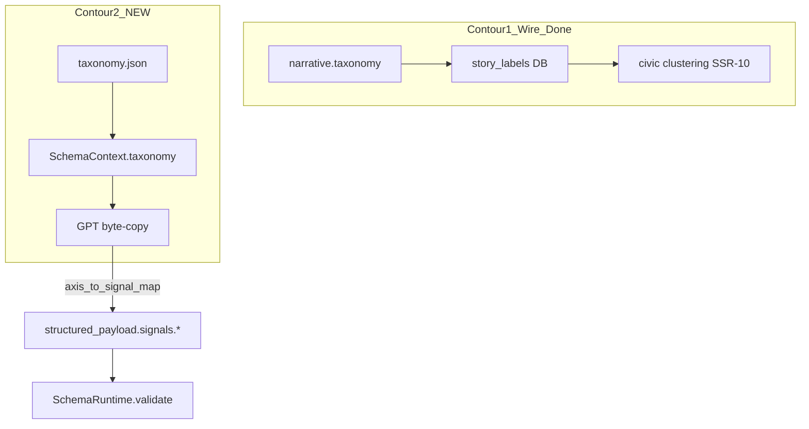

# STORY-GW-SSR-26 — taxonomy.json pack contract + loader

## Meta
- **Key:** `STORY-GW-SSR-26-taxonomy-json-pack-contract`
- **Пакет:** [`semantic-schema-runtime/`](./INDEX.md)
- **Status:** 🔵 Done (Awaiting Commits)
- **Приоритет:** P1 — taxonomy-pack wave (sequence **26**)
- **Тип:** implement (pack contract + loader)
- **Parent REQ:** [`51-semantic-schema-runtime.md`](../../../requirements/51-semantic-schema-runtime.md)
- **Skill declared:** python-pro
- **Git:** только `semantic-schema-runtime` — [INDEX §Git branch](./INDEX.md)
- **Зависит от:** SSR-25 (geo-detail Done)
- **Blocks:** [GW-SSR-28](./STORY-GW-SSR-28-tallinn-civic-taxonomy-json-seed.md), [GW-SSR-29](./STORY-GW-SSR-29-taxonomy-docs-operator-copy-paste-seam.md)
- **Parallel:** [GW-SSR-27](./STORY-GW-SSR-27-geo-precision-instance-territory.md) (orthogonal)
- **Siblings (GPT):** [GPT-SSR-05](../../../../GPT%20UI/docs/tasks/backlog-stories/semantic-schema-runtime/STORY-GPT-SSR-05-taxonomy-json-pack-copy-paste.md)

## Зачем простыми словами

GPT wave 2 требует **literal copy-paste** третьего JSON рядом с `pack.json` и `payload.schema.json`. Сегодня vocabulary (13 осей, canonical keys) и mapping «ось → `structured_payload.signals.*`» живут в GPT Markdown и в Python gateway — **не в pack data**. Оператор при swap ноды правит несколько несвязанных мест → drift.

Эта stori вводит **`taxonomy.json`** в каталог pack (паттерн `payload.schema.json`) и loader. Gateway pack dir = **SSOT для copy-paste** на GPT side. Wire `narrative.taxonomy` (GW-TAX-01) **не меняется**.

---

## Архитектура: два контура taxonomy



| Контур | SSOT | Consumer | As-built |
|--------|------|----------|----------|
| Wire labels | OpenAPI `narrative.taxonomy` | [`intake/contracts.py`](../../../../src/core/intake/contracts.py) → `parse_taxonomy_payload` → `story_labels` | **Done** GW-TAX-01 |
| Pack vocabulary | `taxonomy.json` | Loader → GPT copy → normalizer | **Absent** |

Контуры **связаны продуктово**, но **не сливаются** в один blob на wire.

---

## Verified as-built

### As-of-Done (SSR-26 pkg-000083 / G26 PASS 2026-09-01T13:00:37Z)

| Fact | Evidence |
|------|----------|
| Pack layout README | 3 files + `taxonomy_schema` — [`schema-packs/README.md:11,33,35–46`](../../../../schema-packs/README.md) |
| `SchemaContext.taxonomy` | [`contracts.py:122`](../../../../src/core/schema/contracts.py); types [`:89–107`](../../../../src/core/schema/contracts.py) |
| `load_pack()` taxonomy wire | [`resolver.py:515`](../../../../src/core/schema/resolver.py); parser [`:250–412`](../../../../src/core/schema/resolver.py) |
| Tests | [`test_gw_ssr_26_taxonomy_loader.py`](../../../../tests/test_gw_ssr_26_taxonomy_loader.py) (6) |
| Official packs without `taxonomy_schema` | legal/mobility/tallinn → `taxonomy is None` |
| Orphan `taxonomy.json` on tallinn | exists; **not** auto-loaded without manifest key |
| 13 wire axes / dispositions | unchanged [`axes.py`](../../../../src/core/taxonomy/axes.py) / [`disposition.py`](../../../../src/core/taxonomy/disposition.py) |
| Civic vocab in code | [`cluster/vocabulary.py`](../../../../src/core/cluster/vocabulary.py) — **не pack** (residual) |
| `ClusterLens` | still 10 |

### Historical (отправная точка pre-P3 — 2026-09-01 P1)

| Fact | Evidence (then) |
|------|-----------------|
| Pack layout README | 2 files only — README L7–11 |
| `SchemaContext` fields | ended at `card_fields`; **нет** `taxonomy` (L89–100) |
| `load_pack()` return | dual + card_fields only (L335–346) |
| No `test_gw_ssr_26_*` | tests/ |
| `tallinn pack.json` | **Нет** ключа `taxonomy_schema` (still true As-of-Done — seed = SSR-28) |

---

## Pack contract (SCHEMA-005 — this loader only)

### On-disk layout (after SSR-26 README T00)

```text
schema-packs/<schema_id>/<schema_version>/
  pack.json
  payload.schema.json
  taxonomy.json          ← optional until manifest declares taxonomy_schema
```

### Manifest key

| Key | Type | Semantics |
|-----|------|-----------|
| `taxonomy_schema` | string, optional | Filename relative to pack dir (symmetric with `payload_schema`). **Absent** = no taxonomy block. **Present** = file **required**; missing file → loader error |

### `taxonomy.json` shape (indicator — не frozen dialect)

```json
{
  "schema_id": "tallinn_civic",
  "schema_version": "v1",
  "axes": ["topic_domain", "..."],
  "internal_axes": ["risk_privacy_safety", "confidence_state"],
  "canonical_keys": {
    "topic_domain": [{"key": "transport", "meaning": "..."}]
  },
  "axis_to_signal_map": {
    "topic_domain": "signals.civic_domain",
    "failure_mode": "signals.failure_pattern"
  },
  "dispositions": ["canonical", "metadata_only", "needs_clarification", "rejected", "internal"]
}
```

| Block | Validation rules (loader) |
|-------|---------------------------|
| `schema_id` / `schema_version` | Must match `pack.json` |
| `axes[]` | Non-empty; each ∈ `TAXONOMY_AXIS_VALUES`; **set must equal** all 13 (no missing, no extra) |
| `internal_axes[]` | Each ∈ `axes[]` |
| `canonical_keys` | Object keyed by axis; entries `{key, meaning?}`; **no duplicate keys per axis** |
| `axis_to_signal_map` | Keys ∈ axes; values non-empty dotted paths |
| `dispositions` | Subset of `LABEL_DISPOSITION_VALUES`; default all five if omitted |

---

## Code touchpoints (P3 — exact files)

| Layer | File | Change |
|-------|------|--------|
| Types | [`src/core/schema/contracts.py`](../../../../src/core/schema/contracts.py) | `TaxonomyCanonicalKey`, `TaxonomyPack`; `SchemaContext.taxonomy: TaxonomyPack \| None = None` |
| Loader | [`src/core/schema/resolver.py`](../../../../src/core/schema/resolver.py) | `_parse_taxonomy_pack(pack_dir, manifest, expected)`; wire in `load_pack()` after `card_fields` |
| README | [`schema-packs/README.md`](../../../../schema-packs/README.md) | Layout + key table + link manual §taxonomy (SSR-29) |
| Tests | `tests/test_gw_ssr_26_taxonomy_loader.py` | New file |

**Pattern to copy:** filename indirection like L316–317 (`payload_schema` → read sibling JSON). **Pattern to copy for optional:** `_parse_card_fields` / `_parse_dual_civic_lenses` — key absent → `None`, not error.

**Imports in resolver:** `TAXONOMY_AXIS_VALUES` from `core.taxonomy.axes`; `LABEL_DISPOSITION_VALUES` from `core.taxonomy.disposition`.

---

## Requiredness policy

| Pack | `taxonomy_schema` in manifest | `taxonomy.json` on disk | Expected load |
|------|------------------------------|-------------------------|---------------|
| `legal_process/v1` | absent | absent | OK; `ctx.taxonomy is None` |
| `mobility_observation/v1` | absent | absent | OK |
| `tallinn_civic/v1` | absent (pre-SSR-28) | absent | OK |
| `tallinn_civic/v1` | present (post-SSR-28) | present | OK; taxonomy required |
| any | present | **missing file** | `UnsupportedVersionError` |

SSR-26 **не** добавляет seed (→ SSR-28). Тесты SSR-26 используют `tmp_path` + copied pack fragments ([`test_gw_ssr_11_card_fields_loader.py`](../../../../tests/test_gw_ssr_11_card_fields_loader.py) pattern).

---

## Подзадачи (детализация)

### T00 — Contract / README

- Обновить [`schema-packs/README.md`](../../../../schema-packs/README.md): layout 3 файла; таблица `taxonomy_schema`; блоки `taxonomy.json`; cross-link manual (placeholder до SSR-29).
- **Не:** frozen YAML dialect; не дублировать полный manual.

**Gate:** README grep `taxonomy_schema` + `taxonomy.json`.

---

### T01 — Types (`TaxonomyPack`)

- Добавить frozen dataclasses в `contracts.py`:
  - `TaxonomyCanonicalKey(key, meaning=None)`
  - `TaxonomyPack(schema_id, schema_version, axes, internal_axes, canonical_keys, axis_to_signal_map, dispositions)`
- Расширить `SchemaContext` полем `taxonomy: TaxonomyPack | None = None`.

**Gate:** import `TaxonomyPack` from `core.schema.contracts`; mypy/pycompile clean.

**Не:** менять `TAXONOMY_AXIS_VALUES`; не трогать `ClusterLens`.

---

### T02 — Loader (`_parse_taxonomy_pack`)

Реализовать парсер с fail-fast validation:

1. `taxonomy_schema` absent → return `None`
2. Read JSON from `pack_dir / filename`
3. Validate identity, axes lockstep, internal_axes ⊆ axes
4. Parse `canonical_keys` — reject unknown axis keys, duplicate `key` per axis
5. Parse `axis_to_signal_map`, `dispositions`

Wire в `load_pack()`:

```python
taxonomy=_parse_taxonomy_pack(pack_dir, manifest, expected),
```

**Gate:** `resolve_pack(SchemaRef("legal_process","v1"))` unchanged behavior.

---

### T03 — Requiredness tests matrix

| Test case | Setup | Expect |
|-----------|-------|--------|
| legal/mobility load | official packs | `taxonomy is None` |
| manifest declares schema, file missing | tmp legal pack + `taxonomy_schema` | `UnsupportedVersionError` match `taxonomy file missing` |
| invalid axis in file | tmp tallinn dir + bad axes | `UnsupportedVersionError` match `unknown axis` |
| duplicate canonical key | tmp file governance_signal dup | `UnsupportedVersionError` match `duplicate key` |

**Не:** seed tallinn official tree in SSR-26 (→ SSR-28).

---

### T04 — Tests file

Создать `tests/test_gw_ssr_26_taxonomy_loader.py`:

- `test_clusterlens_baseline_unchanged` — len(`ClusterLens`) == 10 (regression anchor)
- `test_legal_and_mobility_load_without_taxonomy`
- `test_missing_taxonomy_file_when_declared_fails` (tmp_path)
- `test_invalid_axis_in_taxonomy_file_fails` (tmp_path)

Post-SSR-28 add (in SSR-28 story): `test_tallinn_loads_taxonomy_when_manifest_declares_schema`.

---

### T05 — Gate / invariants

Перед Done SSR-26:

- [ ] `pytest tests/test_gw_ssr_26_* -q` green
- [ ] `pytest tests/test_gw_ssr_01_* tests/test_gw_ssr_11_* -q` regression green
- [ ] No edits to `cluster/vocabulary.py`, wire `parse_taxonomy_payload`, `ClusterLens` enum
- [ ] `builder_resolve_queue.py --project gateway --verify` PASS (package scaffold when operator runs wave)

---

## Target / AC

- [x] **AC-GW-SSR26-01:** `schema-packs/README.md` documents `taxonomy_schema` + `taxonomy.json` blocks.
- [x] **AC-GW-SSR26-02:** Loader exposes parsed taxonomy on `SchemaContext` when manifest declares file.
- [x] **AC-GW-SSR26-03:** `legal_process/v1` and `mobility_observation/v1` load with `taxonomy is None`.
- [x] **AC-GW-SSR26-04:** Invalid / duplicate axis or key in taxonomy file → loader error (test-backed).
- [x] **AC-GW-SSR26-05:** `ClusterLens` enum unchanged; GW-TAX-01 wire path unchanged.

---

## Architecture invariants (must hold)

- **Do not** extend `ClusterLens`
- **Do not** change wire `narrative.taxonomy` / GW-TAX-01 persist
- **Do not** replace `vocabulary.py` with pack read (residual)
- **Do not** require taxonomy on legal/mobility at introduction
- Loader = SCHEMA-005 gateway-specific

---

## Dependencies

- SSR-25 Done
- Blocks SSR-28 (data), SSR-29 (docs)
- Unblocks GPT-SSR-05 P3 (gateway loader + path exists)

---

## Residual / out of scope

- Runtime read canonical keys from pack instead of `vocabulary.py`
- Intake enforcement: unknown label keys → 422 (GPT omit sufficient)
- `enforce_policy` coherence taxonomy vs signals (G-POLICY-02)
- GPT instruction edits (GPT-SSR-09)
- Materialize `taxonomy.json` content (SSR-28)
- Geo (SSR-27)

---

## Pitfalls (from dry-run — avoid at P3)

1. **Parsing GPT MD naively** — disposition tokens (`needs_clarification`) must **not** land in `governance_signal` canonical_keys; extract only §4 tables + §5 + §6 (SSR-28 owns extraction spec).
2. **Requiredness flip** — loader ships optional; SSR-28 adds tallinn manifest key → tallinn becomes required. Test both states explicitly.
3. **Orphan file** — `taxonomy.json` on disk without `taxonomy_schema` in manifest must **not** auto-load (manifest is SSOT for presence).
