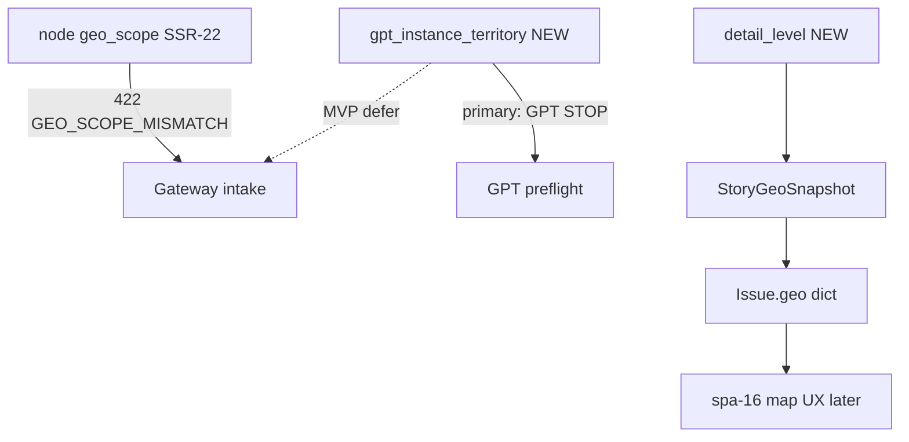

# STORY-GW-SSR-27 — Geo precision index + GPT instance territory (pack contract)

## Meta
- **Key:** `STORY-GW-SSR-27-geo-precision-instance-territory`
- **Пакет:** [`semantic-schema-runtime/`](./INDEX.md)
- **Status:** 🔵 Done (Awaiting Commits)
- **Приоритет:** P1 — geo-precision wave (sequence **27**)
- **Тип:** implement (pack contract + loader + optional wire/persist/projection)
- **Parent REQ:** [`51-semantic-schema-runtime.md`](../../../requirements/51-semantic-schema-runtime.md) · [`35-geo-scope-node-architecture-and-filtering.md`](../../../requirements/35-geo-scope-node-architecture-and-filtering.md)
- **Skill declared:** python-pro
- **Git:** только `semantic-schema-runtime`
- **Зависит от:** SSR-25 Done
- **Parallel-safe:** taxonomy 26/28/29 (orthogonal); shares `pack.json` tallinn keys only
- **Siblings (GPT):** [GPT-SSR-08](../../../../GPT%20UI/docs/tasks/backlog-stories/semantic-schema-runtime/STORY-GPT-SSR-08-geo-precision-instance-territory.md) · [GPT-SSR-06](../../../../GPT%20UI/docs/tasks/backlog-stories/semantic-schema-runtime/STORY-GPT-SSR-06-inbound-validation-post-ssr-delta.md) §6
- **Analysis:** [`cross-project-node-model-portability-gap-2026-09-01.md`](../../../../../docs/analysis/cross-project-node-model-portability-gap-2026-09-01.md) G-GEO-PREC-01, G-GEO-INST-01…03

## Зачем простыми словами

Geo-detail wave (SSR-22…25) закрыл wire sidecar, persist адресной глубины, **node** scope (`geo_scope` → 422) и civic clustering по `admin_*`. Wave 2 добавляет:

1. **Precision index** — семантика «насколько точно мы поняли место» (`detail_level`), не только плоские строки.
2. **GPT instance territory** — зона ответственности Custom GPT (район / bbox / admin_id), **строже или уже** node scope.

Gateway: pack SSOT + optional persist/projection. GPT: STOP + copy — GPT-SSR-08.

---

## Архитектура: три уровня geo (не смешивать)



| Level | Pack key | Enforced by | As-built |
|-------|----------|-------------|----------|
| Node acceptance | `node_clustering.civic.geo_scope` | Gateway 422 | **Done** SSR-22 |
| Instance acceptance | `gpt_instance_territory` | GPT STOP (MVP); gateway optional | **Absent** |
| Place precision | `geo_model` + `detail_level` | GPT emit; gateway persist if sent | **Absent** |

Instance scope **может быть уже** node scope (район ⊂ Tallinn). Node gate **не заменяет** instance gate.

---

## Verified as-built gaps (As-of-Done vs Historical)

### As-of-Done (post-P3 pkg-000084 / G27 PASS 2026-09-01T13:21:04Z)

| Fact | Evidence |
|------|----------|
| `detail_level` on wire | [`GeoDetail`](../../../../src/core/intake/contracts.py) + `GEO_DETAIL_ALLOWED_KEYS` |
| `detail_level` on snapshot | [`StoryGeoSnapshot.detail_level`](../../../../src/core/domain/contracts.py) |
| `detail_level` in payload schema | [`payload.schema.json`](../../../../schema-packs/tallinn_civic/v1/payload.schema.json) enum |
| Issue geo projection UC-G03 | [`mapper.py`](../../../../src/core/projection/mapper.py) — geo without lat/lon when detail_level/admin |
| ProjectionInput | [`input.py`](../../../../src/core/projection/input.py) `geo_detail_level` |
| Pack geo blocks | tallinn `geo_model` + Option B `gpt_instance_territory` admin_token settlement tallinn |
| Merge without inventing coords | [`intake_merge.py`](../../../../src/core/geo/intake_merge.py) SSR-24 rule kept |

### Historical (pre-P3 as-built gaps 2026-09-01)

| Fact | Evidence |
|------|----------|
| No `detail_level` on wire | [`GeoDetail`](../../../../src/core/intake/contracts.py) L114–122 `GEO_DETAIL_ALLOWED_KEYS` — no `detail_level` |
| No `detail_level` on snapshot | [`StoryGeoSnapshot`](../../../../src/core/domain/contracts.py) L27–45 — street/house only |
| No `detail_level` in payload schema | [`payload.schema.json`](../../../../schema-packs/tallinn_civic/v1/payload.schema.json) geo = strings only |
| Issue geo projection | [`mapper.py`](../../../../src/core/projection/mapper.py) L27–42 — builds `geo` **only when lat+lon** |
| ProjectionInput | [`input.py`](../../../../src/core/projection/input.py) — no `geo_detail_level` |
| Bridge geo pass-through | [`extraction_policy.py`](../../../../src/core/projection/extraction_policy.py) L200–206 — admin_* only |
| Merge without coords | [`intake_merge.py`](../../../../src/core/geo/intake_merge.py) L48–50 — provider None + no lat/lon → **None** (SSR-24 rule) |
| Snapshot requires lat/lon | `StoryGeoSnapshot` fields `latitude`, `longitude` — **non-optional float** |
| No bbox intake gate | grep gateway src — absent |
| Node scope only | tallinn `pack.json` `geo_scope`: `settlement:tallinn` |

---

## Pack contract (nested in `pack.json` — P3 decision)

Coherence analysis prefers **nested blocks** in manifest (parallel-safe with SSR-28 `taxonomy_schema`).

### A. `geo_model`

```json
"geo_model": {
  "precision_levels": [
    "region", "settlement", "district", "street", "house", "house_range", "coordinates"
  ],
  "default_precision_inference": "from_address_depth"
}
```

| Field | Loader validation |
|-------|-------------------|
| `precision_levels[]` | Non-empty; each token in frozen set `GEO_PRECISION_LEVELS` (define in `contracts.py` alongside loader) |
| `default_precision_inference` | Optional non-empty string |

### B. `gpt_instance_territory`

```json
"gpt_instance_territory": {
  "enabled": true,
  "rules": [
    { "type": "admin_token", "level": "settlement", "value": "tallinn" }
  ]
}
```

| Rule type | Required fields |
|-----------|-----------------|
| `admin_id` | `level`, `scheme`, `value` |
| `admin_token` | `level`, `value` |
| `bbox` | `west`, `south`, `east`, `north` (numbers) |

Multiple rules: **OR** (any match = inside). Gateway MVP: **parse only**; enforce deferred to GPT.

**Tallinn seed (operator choice at P3):**

- Option A: omit block (full node = full instance)
- Option B: demo `admin_token` settlement tallinn (copy-paste example for GPT-SSR-08)

**Не invent** district/bbox without operator sign-off.

---

## Wire / persist / projection chain

### Precision enum (shared)

`region` | `settlement` | `district` | `street` | `house` | `house_range` | `coordinates`

### Layer matrix

| Layer | File | Change |
|-------|------|--------|
| Parse sidecar | [`intake/contracts.py`](../../../../src/core/intake/contracts.py) | Add `detail_level` to `GeoDetail`, `GEO_DETAIL_ALLOWED_KEYS`; validate ∈ `GEO_PRECISION_LEVELS` in `_parse_geo_detail_block` |
| Has-values | [`intake/contracts.py`](../../../../src/core/intake/contracts.py) `geo_detail_has_values` | Treat non-empty `detail_level` as has-values (enables parse acceptance) |
| Mirror payload | [`geo/intake_merge.py`](../../../../src/core/geo/intake_merge.py) `mirror_geo_to_payload` | Write `geo.detail_level` when present |
| Domain | [`domain/contracts.py`](../../../../src/core/domain/contracts.py) | `StoryGeoSnapshot.detail_level: str \| None = None` |
| Merge | [`intake_merge.py`](../../../../src/core/geo/intake_merge.py) `merge_client_geo_detail` | Propagate `detail_level` on merge; **keep** SSR-24 rule: no invented lat/lon when provider None |
| Payload schema | [`payload.schema.json`](../../../../schema-packs/tallinn_civic/v1/payload.schema.json) | Optional `geo.detail_level` enum |
| SQLite | [`db_sqlite.py`](../../../../src/core/infrastructure/db_sqlite.py) | Column `geo_detail_level`; `_geo_bind`; SELECT/INSERT/UPDATE; `_ensure_sqlite_schema_migrations` |
| Supabase | [`db_supabase.py`](../../../../src/core/infrastructure/db_supabase.py) | `geo_detail_level` in `_story_geo_supabase_fields`; `_STORIES_GEO_DETAIL_COLUMNS`; `_STORY_SELECT_FIELDS` |
| Migration | `supabase/migrations/20260901_*_gw_ssr_27_stories_geo_detail_level.sql` | Pattern [`20260830_2100_gw_ssr_24`](../../../../supabase/migrations/20260830_2100_gw_ssr_24_stories_geo_detail.sql): omit-probe, not in `required_columns_ready` |
| Projection input | [`projection/input.py`](../../../../src/core/projection/input.py) | `geo_detail_level: str \| None = None` |
| Extraction | [`extraction_policy.py`](../../../../src/core/projection/extraction_policy.py) | Pass `geo_snapshot.detail_level` |
| Mapper | [`mapper.py`](../../../../src/core/projection/mapper.py) | Add `detail_level` to Issue.`geo`; **UC-G03:** emit geo dict when `detail_level` and/or admin fields present **even without lat/lon** |
| Types + loader | [`schema/contracts.py`](../../../../src/core/schema/contracts.py), [`resolver.py`](../../../../src/core/schema/resolver.py) | `GeoModelBlock`, `GptInstanceTerritoryBlock`; `_parse_geo_model`, `_parse_gpt_instance_territory` |
| README | [`schema-packs/README.md`](../../../../schema-packs/README.md) | Document blocks (T00) |

---

## Product rules (GPT implements — gateway persists if sent)

| Resident evidence | `detail_level` | Gateway note |
|-------------------|----------------|--------------|
| City only | `settlement` | No invented street |
| District only | `district` | Coords optional |
| House confirmed | `house` or `coordinates` | Coords may exist |
| Region-level civic | `region` | Issue map must not imply point pin (UC-G03) |

---

## Edge case: region-only without lat/lon (document at P3)

**As-built constraint:** `StoryGeoSnapshot` requires `latitude`/`longitude`; `merge_client_geo_detail` returns `None` without coords when provider miss (SSR-24).

| Path | MVP behavior |
|------|--------------|
| Wire sends `detail_level` + lat/lon | Full persist + projection |
| Wire sends `detail_level` + admin in `structured_payload.geo` (mirror) | Persist via coords path if geocoder filled snapshot; else projection may read payload at promote time — **defer full region-only snapshot** unless product explicitly extends merge |
| UC-G03 region-only | **Must** project `Issue.geo.detail_level` + `region` without lat/lon even if snapshot null — mapper change required (T04) |

**Не** invent `0.0` coords to satisfy NOT NULL — rejected in dry-run.

---

## Use-case matrix

| UC | As-built SSR-25 | SSR-27 closes |
|----|-----------------|---------------|
| G01 city only | strings | + `detail_level=settlement` |
| G02 street+house | address depth | + `detail_level=house` |
| G03 region, not point | geo.region string | + `detail_level=region`; no false pin |
| G04 instance=Tallinn | node geo_scope | unchanged |
| G05 instance=district | gap | `gpt_instance_territory` |
| G06 bbox territory | gap | bbox rule |
| G07 admin_id | gap | admin_id + scheme |
| G08 out-of-node | 422 | unchanged |
| G09 out-of-instance | no GPT rule | GPT STOP (GPT-SSR-08) |
| G10 spa halo vs pin | pin if coords | `Issue.geo.detail_level` |

---

## Подзадачи (детализация)

### T00 — Contract / README

- Document `geo_model`, `gpt_instance_territory`, `detail_level` wire/snapshot/projection in [`schema-packs/README.md`](../../../../schema-packs/README.md)
- Three-level geo diagram reference → manual (T06 / SSR-29 merge for taxonomy only)

---

### T01 — Types

In `contracts.py`:

- `GEO_PRECISION_LEVELS: frozenset[str]`
- `GPT_INSTANCE_RULE_TYPES: frozenset[str]`
- `GeoModelBlock`, `GptInstanceTerritoryRule`, `GptInstanceTerritoryBlock`
- `SchemaContext.geo_model`, `SchemaContext.gpt_instance_territory` optional fields

---

### T02 — Loader

- `_parse_geo_model(manifest)` — optional absent
- `_parse_gpt_instance_territory(manifest)` — validate rule types and required subfields
- Wire in `load_pack()` parallel to taxonomy (orthogonal)

**Tests:** legal/mobility load with `geo_model is None`; invalid level → error (tmp_path)

---

### T03 — Wire + persist

1. Intake parse `detail_level` (unit: `_parse_geo_detail_block`; integration: `valid_v2_intake_payload` + geo_detail)
2. `StoryGeoSnapshot.detail_level`
3. DB column + adapters (SSR-24 pattern)
4. `payload.schema.json` enum property

**Regression anchors:** `test_gw_ssr_23_*`, `test_gw_ssr_24_*`, `test_gw_ssr_25_*`

**Migration test:** `test_migration_sql_on_disk` in SSR-27 file; SSR-24 test keeps **SSR-24-only** column set (do not assert `geo_detail_level` in SSR-24 migration file)

---

### T04 — Projection

1. `ProjectionInput.geo_detail_level`
2. `build_projection_input_from_draft` propagation
3. `project_distinct_issue`:
   - When lat+lon: include `detail_level` if set
   - When no lat/lon but `detail_level` and/or admin: build partial geo dict (UC-G03)

**Не:** street/house on Issue (REQ-51 §3)

---

### T05 — Tests

File: `tests/test_gw_ssr_27_geo_precision.py`

| Test | Covers |
|------|--------|
| loader tallinn geo blocks | T02 |
| legal absent blocks | T02 |
| invalid geo_model level | T02 |
| `_parse_geo_detail_block` valid/invalid | T03 |
| sqlite roundtrip detail_level | T03 |
| projection detail_level without coords | T04 |
| `build_projection_input_from_draft` propagates | T04 |
| payload schema has detail_level | T03 |

---

### T06 — Docs (manual merge)

Update [`schema-packs-node-data-model-ru.md`](../../../runtime-docs/manuals/schema-packs-node-data-model-ru.md):

- §three-level geo (node / instance / precision)
- Cross-link GPT-SSR-08, GPT-SSR-06 §6

**Coordination:** SSR-29 adds taxonomy § in **same manual pass** if both land same package — avoid duplicate/conflicting layout sections.

---

## Optional P3 split (operator)

If overnight scope large:

| Sub | Scope |
|-----|-------|
| 27a | T00–T02 pack+loader |
| 27b | T03 persist+migration |
| 27c | T04–T06 projection+docs |

Backlog stays one story until operator splits package.

---

## Target / AC

- [x] **AC-GW-SSR27-01:** README documents `geo_model` + `gpt_instance_territory` + node vs instance separation.
- [x] **AC-GW-SSR27-02:** Loader exposes parsed blocks; absent = optional, no break legal/mobility.
- [x] **AC-GW-SSR27-03:** `detail_level` documented and implemented wire → snapshot → Issue.geo (tests T03/T04).
- [x] **AC-GW-SSR27-04:** `gpt_instance_territory` supports `admin_id`, `admin_token`, `bbox` in loader spec.
- [x] **AC-GW-SSR27-05:** SSR-22 regression green (`test_gw_ssr_22_*`).
- [x] **AC-GW-SSR27-06:** GPT-SSR-08 Meta cross-link satisfied (pack blocks on disk for copy).

---

## Architecture invariants

- **Do not** extend `ClusterLens`
- **Do not** change `geo_filter` / civic bucket formula (admin_* only)
- **Do not** merge node `geo_scope` with instance territory semantics
- **Do not** add HTTP geo-filter endpoints
- **Do not** put street/house on Issue projection
- Gateway instance bbox gate = **residual** (GPT-only MVP OK)

---

## Cross-project (GPT — не materialize здесь)

| GPT | Expectation from gateway |
|-----|-------------------------|
| GPT-SSR-08 | Pack blocks copy-paste; GPT pre-flight STOP |
| GPT-SSR-06 §6 | Out-of-instance resident copy |
| spa-16 | Consumes `Issue.geo.detail_level` when present |

---

## Residual

- Gateway enforce instance territory on intake (vs GPT-only)
- Polygon territory
- EHAK vs NUTS product standard
- Full region-only snapshot without coords (type/merge policy change)
- REQ-51 Status line operator sync when package executes

---

## Pitfalls (from dry-run)

1. **Invented coords `(0.0, 0.0)`** for address-only — breaks SSR-24 semantics; rejected.
2. **Mapper lat/lon-only** — blocks UC-G03; must extend geo dict builder.
3. **SSR-24 migration test** — extending `_STORIES_GEO_DETAIL_COLUMNS` breaks SSR-24 migration file assertion; split column sets in tests.
4. **`geo_detail_has_values`** without `detail_level` — sidecar with only precision token silently dropped at parse boundary.
