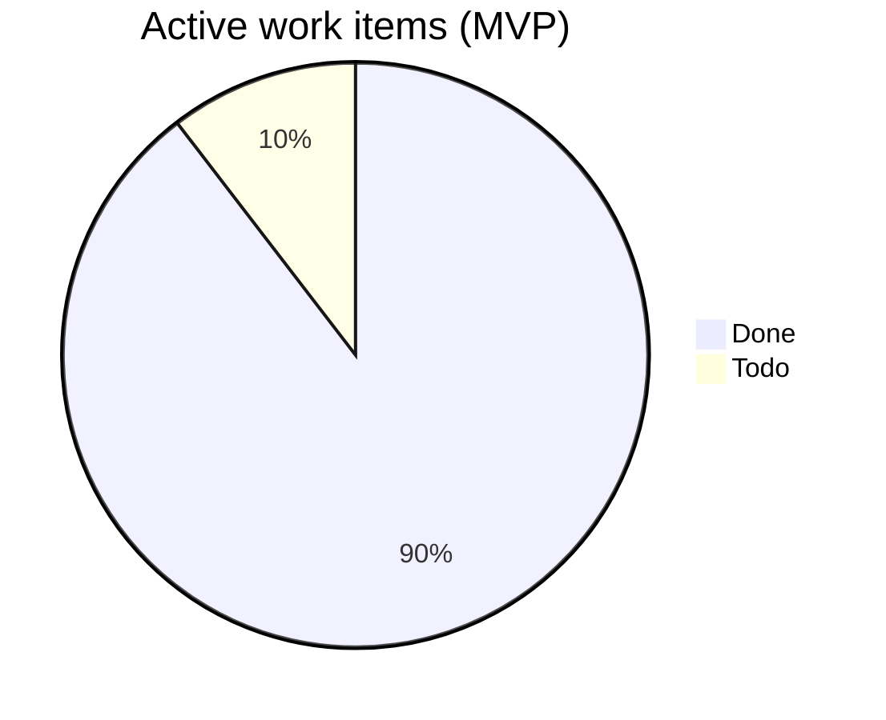

# Gateway · scope dashboard

> **Scope-Id:** mvp  
> **Scope:** MVP  
> **SSOT:** package `INDEX.md` files + [bullrun-launch-index.md](bullrun-launch-index.md)  
> **Updated:** 2026-10-15T10:42:18Z  
> **Last change:** Materialize REQ57 backlog package `req57-issue-sense-brief-poster` (4 stories Todo) + ENV-CHECKLIST; public keys / env / brief-wins locked.

## Summary

| Metric | Value |
|--------|-------|
| Backlog packages | 13 |
| Active work items | 48 |
| Done | 43 |
| Todo / In Progress | 5 |
| Deferred | 3 |
| **Overall progress (active)** | **~90%** `███████████░` |

*Active = MVP Done packages + TASK-ES-04 Todo + REQ57-01…04 Todo. Deferred вне %.*  
*SSR + REQ7 THR packages remain outside this denominator (separate scope dashboards).*  
*REQ9 + REQ10 + REQ11 + REQ56 + **REQ57** packages are on this board (operator lock).*

## By package

| Package | Stories | Done | Todo | Deferred | Progress |
|---------|---------|------|------|----------|----------|
| [story-draft-handoff](backlog-stories/story-draft-handoff/INDEX.md) | 7 | 7 | 0 | 0 | 100% `████████████` |
| [issues-read-contract](backlog-stories/issues-read-contract/INDEX.md) | 8 | 8 | 0 | 0 | 100% `████████████` |
| [demo-data-seeding](backlog-stories/demo-data-seeding/INDEX.md) | 4 | 4 | 0 | 0 | 100% `████████████` |
| [localization-l10n](backlog-stories/localization-l10n/INDEX.md) | 4 | 3 | 0 | 1 | 75% `█████████░░░` |
| [gpt-submit-authz](backlog-stories/gpt-submit-authz/INDEX.md) | 2 | 2 | 0 | 0 | 100% `████████████` |
| [cabinet-api](backlog-stories/cabinet-api/INDEX.md) | 3 | 2 | 0 | 1 | 67% `████████░░░░` |
| [taxonomy-fidelity](backlog-stories/taxonomy-fidelity/INDEX.md) | 4 | 3 | 0 | 1 | 100% active `████████████` |
| [early-signal-pre-cluster](backlog-stories/early-signal-pre-cluster/INDEX.md) | 4 items | 3 | 1 | 0 | 75% `█████████░░░` |
| [req9-ops-parity-env-naming](backlog-stories/req9-ops-parity-env-naming/INDEX.md) | 2 | 2 | 0 | 0 | 100% `████████████` |
| [req10-lifecycle-status-normalize](backlog-stories/req10-lifecycle-status-normalize/INDEX.md) | 2 | 2 | 0 | 0 | 100% `████████████` |
| [req11-demo-life-sim-fixtures-and-replay](backlog-stories/req11-demo-life-sim-fixtures-and-replay/INDEX.md) | 5 | 5 | 0 | 0 | 100% `████████████` |
| [req56-issues-server-text-search](backlog-stories/req56-issues-server-text-search/INDEX.md) | 2 | 2 | 0 | 0 | 100% `████████████` |
| [req57-issue-sense-brief-poster](backlog-stories/req57-issue-sense-brief-poster/INDEX.md) | 4 | 0 | 4 | 0 | 0% `░░░░░░░░░░░░` |

*gpt-submit-authz: GAUTH-01/02 Superseded — excluded from story counts.*  
*cabinet-api: GW-CAB-03 Deferred (post-MVP web3).*  
*taxonomy-fidelity: TAX-01/02/03 Done; **TAX-04 Deferred**.*  
*early-signal: TASK-ES-01/ES-02/ES-03 Done; TASK-ES-04 Todo.*  
*req9/10/11/56: packages Done on this board.*  
*req57-issue-sense-brief-poster: REQ57-01…04 **Todo** scaffold 2026-10-15; env [`ENV-CHECKLIST.md`](backlog-stories/req57-issue-sense-brief-poster/ENV-CHECKLIST.md).*

## Remaining

| Type | Key | Title | Package/Epic | Status | Priority | Essence |
|------|-----|-------|--------------|--------|----------|---------|
| Story | [STORY-GW-REQ57-01](backlog-stories/req57-issue-sense-brief-poster/STORY-GW-REQ57-01-bind-in-projection-apply.md) | Bind-in + projection apply | req57 | ⚪ Todo | — | `/v1/issue-sense-brief/bind` + public keys |
| Story | [STORY-GW-REQ57-02](backlog-stories/req57-issue-sense-brief-poster/STORY-GW-REQ57-02-nudge-on-create-publish.md) | Thin nudge on create/publish | req57 | ⚪ Todo | — | accept + S2S env |
| Story | [STORY-GW-REQ57-03](backlog-stories/req57-issue-sense-brief-poster/STORY-GW-REQ57-03-sweep-retry-sense-brief.md) | Sweep / retry | req57 | ⚪ Todo | — | ClusterCronJob recover |
| Story | [STORY-GW-REQ57-04](backlog-stories/req57-issue-sense-brief-poster/STORY-GW-REQ57-04-manual-regenerate-service.md) | Manual regenerate | req57 | ⚪ Todo | — | service-auth version bump |
| Task | [TASK-GW-ES-04](backlog-stories/early-signal-pre-cluster/TASK-GW-ES-04-req48-spa15-contract-seam.md) | REQ-48 PA.2 + spa-15 seam | early-signal | ⚪ Todo | — | Docs/contract; no API |

## Requirements (intake)

| REQ | Title | Status | Notes |
|-----|-------|--------|-------|
| [58](../requirements/58-req13-existing-issues-sense-brief-backfill-via-regenerate.md) | REQ13 — backfill existing Issues via regenerate | **Draft · locks closed** | CLI batch; corpus `{stories}`; dry-run; skip ready; sibling REQ-10 |
| [57](../requirements/57-req13-issue-sense-brief-poster-projection.md) | REQ13 — sense brief + poster projection | Draft · stories Done | Package [`req57-…`](backlog-stories/req57-issue-sense-brief-poster/INDEX.md); REQ57-01…04; peer handoff |
| [56](../requirements/56-issues-server-text-search.md) | Issues server text search (`search`) | **Ready** | REQ56-01/02 Done pkg-000111/112; SPA DUI-Q12 until FE enable |
| [55](../requirements/55-req11-demo-life-sim-fixtures-and-replay.md) | REQ11 — demo life sim fixtures + replay | Draft — stories Done | REQ11-01…05 Done pkg-000100…104 |
| [54](../requirements/54-req10-lifecycle-status-normalize.md) | REQ10 — lifecycle_status normalize | Draft — awaiting PA.2 | REQ10-01/02 Done pkg-000098/099 |
| [53](../requirements/53-req9-ops-parity-env-naming.md) | REQ9 — ops parity & env naming | Draft — awaiting PA.2 | REQ9-01/02 Done pkg-000096/097 |
| [48](../requirements/48-early-signal-pre-cluster-data-readiness.md) | Early Signal / Pre-Cluster — Data Readiness | Draft — awaiting PA.2 | ES-02/03 Done; TASK-ES-04 Todo |

## Doc-tasks Done (в active %)

| Key | Package | Evidence |
|-----|---------|----------|
| [DOC-TASK-CRON-SCOPE-01](backlog-stories/demo-data-seeding/DOC-TASK-CRON-SCOPE-01-clarify-cron-in-mvp.md) | demo-data-seeding | Done 2026-07-23 — MVP-cron vs post-demo automation в доке |
| [DOC-TASK-CRON-SCOPE-02](backlog-stories/demo-data-seeding/DOC-TASK-CRON-SCOPE-02-architecture-ssot-mvp-cron.md) | demo-data-seeding | Done 2026-07-23 — Architecture SSOT G1–G4 caveat MVP-cron |
| [DOC-TASK-DRAFT-OWNERSHIP-01](backlog-stories/cabinet-api/DOC-TASK-DRAFT-OWNERSHIP-01-clarify-capability-model.md) | cabinet-api | Done 2026-07-23 — capability + first-wins `set_owner` для story-drafts |
| [TASK-GW-ES-01](backlog-stories/early-signal-pre-cluster/TASK-GW-ES-01-early-signal-data-readiness-inventory.md) | early-signal-pre-cluster | Done 2026-08-09 — [gap-analysis](backlog-stories/early-signal-pre-cluster/gap-analysis-early-signal-data-readiness-2026-08-09.md) SSOT |

## Epic rollup

| Epic | Status | Notes |
|------|--------|-------|
| [EPIC-M2-21](epics/) | Done (Awaiting Commits) | DRAFT-01..07 Done; pkg-000056 |
| EPIC-M2-06 | Done (package) | PUBLIC-01 Done; L10N-04 deferred |
| EPIC-M2-19 | Done (Awaiting Commits) | SEED-01..04 Done; hosted board 9 cards |
| EPIC-M2-20 | Done | GAUTH historical; superseded user path |
| EPIC-M2-22 | In Progress | CAB-01/02 Done; **GW-CAB-03 Deferred** post-MVP |
| EPIC-M2-23 | Done active / Deferred hygiene | TAX-01/02/03 Done; **TAX-04 Deferred** |
| [EPIC-M2-24](epics/EPIC-M2-24-early-signal-pre-cluster.md) | ES-02/ES-03 Done | TASK-ES-04 Todo |
| [EPIC-req9-ops-parity-env-naming](epics/EPIC-req9-ops-parity-env-naming.md) | 🔵 Done | pkg-000096 + pkg-000097 |
| [EPIC-req10-lifecycle-status-normalize](epics/EPIC-req10-lifecycle-status-normalize.md) | 🔵 Done | pkg-000098 + pkg-000099 |
| [EPIC-req11-demo-life-sim-fixtures-and-replay](epics/EPIC-req11-demo-life-sim-fixtures-and-replay.md) | 🔵 Done* | REQ11-01…05 Done pkg-000100…104 |
| [EPIC-req56-issues-server-text-search](epics/EPIC-req56-issues-server-text-search.md) | 🔵 Done | pkg-000111 + pkg-000112 |

## Roadmap → 100%

**Текущая точка:** active **43/48 (~90%)**. Remaining: **REQ57-01…04**, **TASK-ES-04**. Deferred: GW-CAB-03, GW-L10N-04, **GW-TAX-04**.

| Цель | Знаменатель | Как закрыть |
|------|-------------|-------------|
| **Активные 100%** | 48 work items | REQ57-01→04; TASK-ES-04 |
| **Полные 100%** | + 3 deferred | CAB-03, L10N-04, TAX-04 после web3 / product / ops residual |

### Упорядоченный остаток (active then deferred)

| # | Item | Почему здесь |
|---|------|--------------|
| 1 | [STORY-GW-REQ57-01](backlog-stories/req57-issue-sense-brief-poster/STORY-GW-REQ57-01-bind-in-projection-apply.md) | Bind-in + public wire |
| 2 | [STORY-GW-REQ57-02](backlog-stories/req57-issue-sense-brief-poster/STORY-GW-REQ57-02-nudge-on-create-publish.md) | Nudge after 01 |
| 3 | [STORY-GW-REQ57-03](backlog-stories/req57-issue-sense-brief-poster/STORY-GW-REQ57-03-sweep-retry-sense-brief.md) | Sweep after 01+02 |
| 4 | [STORY-GW-REQ57-04](backlog-stories/req57-issue-sense-brief-poster/STORY-GW-REQ57-04-manual-regenerate-service.md) | Regenerate after 01+02 |
| 5 | [TASK-GW-ES-04](backlog-stories/early-signal-pre-cluster/TASK-GW-ES-04-req48-spa15-contract-seam.md) | Docs/PA.2 seam |
| — | [GW-TAX-04](backlog-stories/taxonomy-fidelity/STORY-GW-TAX-04-alter-story-labels-uuid-residual-hosts.md) | ALTER residual UUID hosts |
| — | [GW-CAB-03](backlog-stories/cabinet-api/STORY-GW-CAB-03-contribution-layer-api.md) / [GW-L10N-04](backlog-stories/localization-l10n/STORY-GW-L10N-04-label-taxonomy-registry-future.md) | Deferred post-MVP |

## §Now

1. **REQ57 backlog scaffold:** [`req57-issue-sense-brief-poster`](backlog-stories/req57-issue-sense-brief-poster/INDEX.md) — fill [`ENV-CHECKLIST.md`](backlog-stories/req57-issue-sense-brief-poster/ENV-CHECKLIST.md); next story work REQ57-01.
2. Lead product seam: [TASK-GW-ES-04](backlog-stories/early-signal-pre-cluster/TASK-GW-ES-04-req48-spa15-contract-seam.md).
3. REQ56 / REQ11 / REQ10 / REQ9 packages **closed** on this board.
4. Deferred TAX-04 / CAB-03 / L10N-04 — только по явному решению.

## §Deferred

- [GW-TAX-04](backlog-stories/taxonomy-fidelity/STORY-GW-TAX-04-alter-story-labels-uuid-residual-hosts.md) — ALTER `story_labels` на residual UUID hosts (TAX-03 audit G2).
- [GW-CAB-03](backlog-stories/cabinet-api/STORY-GW-CAB-03-contribution-layer-api.md) — contribution API; нет MVP-источника `TxReceipt` (отложено 2026-07-14).
- [GW-L10N-04](backlog-stories/localization-l10n/STORY-GW-L10N-04-label-taxonomy-registry-future.md) — полный реестр меток; порог ≥50 label-miss / 7 дней.

## §Retired (optional)

- **GW-DEPLOY-01** — удалён; as-built [`railpack.json`](../../railpack.json). Closure: [retire-STORY-GW-DEPLOY-01-2026-07-10.md](../analysis/retire-STORY-GW-DEPLOY-01-2026-07-10.md)

## §Deploy (optional)

Gateway на Railway: [`railpack.json`](../../railpack.json) + env (`SERVICE_API_TOKEN`, `IDENTITY_BASE_URL`, `SPA_BASE_URL`, `DB_BACKEND=supabase`, `CORS_ALLOWED_ORIGINS`). REQ57 adds: `AIBRIDGE_BASE_URL`, `AIBRIDGE_WORKER_SENSE_BRIEF_S2S_TOKEN`, `AIBRIDGE_SENSE_BRIEF_NUDGE_ENABLED` — see [`ENV-CHECKLIST.md`](backlog-stories/req57-issue-sense-brief-poster/ENV-CHECKLIST.md).

## Mermaid — completion

## How to refresh

1. Recount: package `INDEX.md` + doc-task files (не из памяти).
2. Обновить этот файл по [`backlog-dashboard-template.md`](../../../docs/methodology/Zeya888-builder-queue/workflow/backlog-dashboard-template.md).
3. `npm run dashboard:aggregate`
4. [`backlog-dashboard-maintenance.md`](../../../docs/methodology/Zeya888-builder-queue/workflow/backlog-dashboard-maintenance.md)
