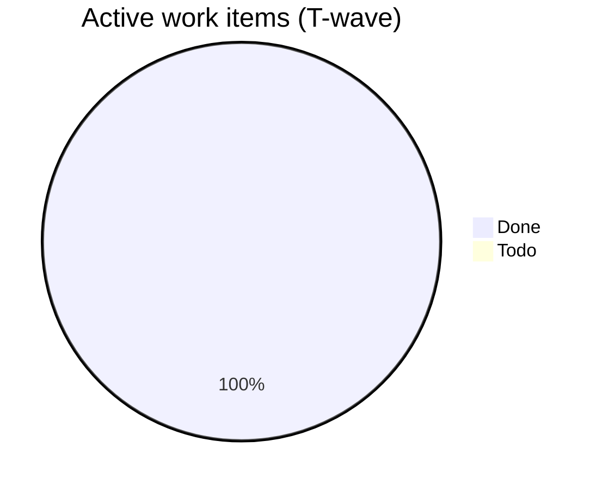

# Gateway · scope dashboard

> **Scope-Id:** semantic-schema-runtime  
> **Scope:** Semantic Schema Runtime (T-wave + post-T-wave 08–15 + node-schema 16–18 + cluster-knobs 19–21 + geo-detail 22–25)  
> **SSOT:** [package INDEX.md](backlog-stories/semantic-schema-runtime/INDEX.md) · [REQ-51](../requirements/51-semantic-schema-runtime.md)  
> **Updated:** 2026-08-30T19:57:31Z  
> **Last change:** SSR-24 G24 PASS (pkg-000081 T01–T07) 2026-08-30T21:00:56Z. Geo-detail 22–24 Done; 25 Todo. Pie T-wave не трогали. MVP snapshot **не** менялся.

**Исполнение:** git branch **`semantic-schema-runtime`** (имя пакета) до P1.3/P3 — сначала [cluster-knobs](backlog-stories/semantic-schema-runtime/orchestrator-cluster-knobs-runbook.md) **19→21**, затем [geo-detail](backlog-stories/semantic-schema-runtime/orchestrator-geo-detail-runbook.md) **22→25**. T-wave / post-T-wave / node-schema runbook — Done (не очередь). Не смешивать с [`gateway-mvp-dashboard.md`](gateway-mvp-dashboard.md).

## Summary

| Metric | Value |
|--------|-------|
| Backlog packages | 1 |
| Active work items (T-wave) | 5 |
| Done (T-wave) | 5 |
| Todo (geo-detail, не в T-wave %) | 4 |
| Draft (post-T-wave + experimental, not in %) | 3 |
| Deferred | 0 |
| **Overall progress (T-wave active)** | **100%** `████████████`

*Active % = T-wave product stories SSR-01…05. SSR-08…15 Done post-T-wave. SSR-16…18 Done node-schema. SSR-19–20 Done cluster-knobs; SSR-21 Todo. SSR-22…25 Todo geo-detail (не в %). SSR-12 / SSR-06/07 = Draft, вне %.*

## By package

| Package | Stories | Done | Todo | Draft later | Deferred | Progress (T-wave) |
|---------|---------|------|------|-------------|----------|-------------------|
| [semantic-schema-runtime](backlog-stories/semantic-schema-runtime/INDEX.md) | 5 T-wave + 11 done post/node/knobs + 6 todo (2 knobs + 4 geo) + 3 draft | 5 | 6 | 3 | 0 | 100% `████████████` |

## Remaining

| Type | Key | Title | Package/Epic | Status | Priority | Essence |
|------|-----|-------|--------------|--------|----------|---------|
| story | [GW-SSR-01](backlog-stories/semantic-schema-runtime/STORY-GW-SSR-01-schema-runtime-pack-load.md) | SchemaRuntime + pack load | [semantic-schema-runtime](backlog-stories/semantic-schema-runtime/INDEX.md) | 🔵 Done (Awaiting Commits) | MED | In-process runtime + SCHEMA-005 pack |
| story | [GW-SSR-02](backlog-stories/semantic-schema-runtime/STORY-GW-SSR-02-structured-payload-persist.md) | structured_payload persist | [semantic-schema-runtime](backlog-stories/semantic-schema-runtime/INDEX.md) | 🔵 Done (Awaiting Commits) | MED | Binding + JSONB + payload_hash |
| story | [GW-SSR-03](backlog-stories/semantic-schema-runtime/STORY-GW-SSR-03-optional-v2-semantic-wire.md) | optional `schema_binding` on v2 | [semantic-schema-runtime](backlog-stories/semantic-schema-runtime/INDEX.md) | 🔵 Done (Awaiting Commits) | MED | Parser once; civic without block |
| story | [GW-SSR-04](backlog-stories/semantic-schema-runtime/STORY-GW-SSR-04-schema-driven-cluster-lens.md) | schema-driven exact lens | [semantic-schema-runtime](backlog-stories/semantic-schema-runtime/INDEX.md) | 🔵 Done (Awaiting Commits) | MED | Pack lens; civic ClusterLens green |
| story | [GW-SSR-05](backlog-stories/semantic-schema-runtime/STORY-GW-SSR-05-schema-lens-promotion-t-wave-close.md) | pack promotion + T-wave close | [semantic-schema-runtime](backlog-stories/semantic-schema-runtime/INDEX.md) | 🔵 Done (Awaiting Commits) | MED | CL-006; no QRY HTTP |
| story | [GW-SSR-08](backlog-stories/semantic-schema-runtime/STORY-GW-SSR-08-tallinn-civic-schema-pack.md) | Tallinn civic as schema pack | [semantic-schema-runtime](backlog-stories/semantic-schema-runtime/INDEX.md) | 🔵 Done (Awaiting Commits) | MED | Civic-модель как `tallinn_civic/v1`; не трогать `ClusterLens` |
| story | [GW-SSR-09](backlog-stories/semantic-schema-runtime/STORY-GW-SSR-09-hosted-apply-and-pack-image.md) | hosted apply + packs in image | [semantic-schema-runtime](backlog-stories/semantic-schema-runtime/INDEX.md) | 🔵 Done (Awaiting Commits) | MED | Миграция binding; паки в деплое; G9 hosted apply = operator |
| story | [GW-SSR-10](backlog-stories/semantic-schema-runtime/STORY-GW-SSR-10-civic-taxonomy-and-exact-lenses.md) | taxonomy + exact on one story | [semantic-schema-runtime](backlog-stories/semantic-schema-runtime/INDEX.md) | 🔵 Done (Awaiting Commits) | MED | Dual civic+pack; enum не расширять |
| story | [GW-SSR-13](backlog-stories/semantic-schema-runtime/STORY-GW-SSR-13-abstract-node-public-api.md) | abstract `/node/*` public API | [semantic-schema-runtime](backlog-stories/semantic-schema-runtime/INDEX.md) | 🔵 Done (Awaiting Commits) | MED | Hard cut `/tallinn/*`; SPA path-rename |
| story | [GW-SSR-11](backlog-stories/semantic-schema-runtime/STORY-GW-SSR-11-pack-declared-issue-projection.md) | pack-declared Issue projection | [semantic-schema-runtime](backlog-stories/semantic-schema-runtime/INDEX.md) | 🔵 Done (Awaiting Commits) | MED | Allowlist на `/node/issues`; named `schema_card`; не dump payload |
| story | [GW-SSR-14](backlog-stories/semantic-schema-runtime/STORY-GW-SSR-14-docs-abstract-node-paradigm.md) | docs abstract node paradigm | [semantic-schema-runtime](backlog-stories/semantic-schema-runtime/INDEX.md) | 🔵 Done (Awaiting Commits) | MED | Инвентарь runtime-docs / REQ / spa-15/16 |
| story | [GW-SSR-15](backlog-stories/semantic-schema-runtime/STORY-GW-SSR-15-tests-abstract-node-and-scenarios.md) | tests `/node` + scenarios | [semantic-schema-runtime](backlog-stories/semantic-schema-runtime/INDEX.md) | 🔵 Done (Awaiting Commits) | MED | pytest paths + civic/pack/404 |
| story | [GW-SSR-16](backlog-stories/semantic-schema-runtime/STORY-GW-SSR-16-node-active-schema-config.md) | node active schema config | [semantic-schema-runtime](backlog-stories/semantic-schema-runtime/INDEX.md) | 🔵 Done (Awaiting Commits) | MED | `NODE_SCHEMA_ID`/`VERSION` required; boot resolve |
| story | [GW-SSR-17](backlog-stories/semantic-schema-runtime/STORY-GW-SSR-17-intake-active-schema-gate.md) | intake active schema gate | [semantic-schema-runtime](backlog-stories/semantic-schema-runtime/INDEX.md) | 🔵 Done (Awaiting Commits) | MED | Нет/mismatch binding → 4xx |
| story | [GW-SSR-18](backlog-stories/semantic-schema-runtime/STORY-GW-SSR-18-cluster-active-schema.md) | cluster active schema | [semantic-schema-runtime](backlog-stories/semantic-schema-runtime/INDEX.md) | 🔵 Done (Awaiting Commits) | MED | Pack только если persist == env; мануал |
| story | [GW-SSR-19](backlog-stories/semantic-schema-runtime/STORY-GW-SSR-19-node-clustering-pack-contract.md) | node clustering pack contract | [semantic-schema-runtime](backlog-stories/semantic-schema-runtime/INDEX.md) | 🔵 Done (Awaiting Commits) | MED | As-of-Done: `node_clustering.civic` loader + pack data; factory still CLUSTER_* |
| story | [GW-SSR-20](backlog-stories/semantic-schema-runtime/STORY-GW-SSR-20-node-clustering-runtime-wire.md) | node clustering runtime wire | [semantic-schema-runtime](backlog-stories/semantic-schema-runtime/INDEX.md) | 🔵 Done (Awaiting Commits) | MED | Factory/handlers из активного pack; семантические CLUSTER_* убраны |
| story | [GW-SSR-21](backlog-stories/semantic-schema-runtime/STORY-GW-SSR-21-node-clustering-docs.md) | node clustering docs | [semantic-schema-runtime](backlog-stories/semantic-schema-runtime/INDEX.md) | 🔵 Done (Awaiting Commits) | MED | Два контура; 05-env / server-env |
| story | [GW-SSR-22](backlog-stories/semantic-schema-runtime/STORY-GW-SSR-22-civic-geo-gate-hardening.md) | civic geo-gate hardening | [semantic-schema-runtime](backlog-stories/semantic-schema-runtime/INDEX.md) | 🔵 Done (Awaiting Commits) | MED | Silent skip убран; T00=intake 4xx |
| story | [GW-SSR-23](backlog-stories/semantic-schema-runtime/STORY-GW-SSR-23-geo-detail-intake-contract.md) | geo_detail wire + geo_intake | [semantic-schema-runtime](backlog-stories/semantic-schema-runtime/INDEX.md) | 🔵 Done (Awaiting Commits) | MED | Wire `geo_detail` + pack policy |
| story | [GW-SSR-24](backlog-stories/semantic-schema-runtime/STORY-GW-SSR-24-geo-detail-persist.md) | geo detail persist | [semantic-schema-runtime](backlog-stories/semantic-schema-runtime/INDEX.md) | 🔵 Done (Awaiting Commits) | MED | G24 PASS 2026-08-30T21:00:56Z; snapshot depth + SQL + mirror |
| story | [GW-SSR-25](backlog-stories/semantic-schema-runtime/STORY-GW-SSR-25-geo-detail-clustering-docs.md) | geo clustering + docs | [semantic-schema-runtime](backlog-stories/semantic-schema-runtime/INDEX.md) | 🔵 Done (Awaiting Commits) | MED | G25 PASS 2026-08-30T21:27:05Z; civic/pack cluster + мануал |

## Requirements (intake)

| REQ | Title | Status | Notes |
|-----|-------|--------|-------|
| [51](../requirements/51-semantic-schema-runtime.md) | Semantic Schema Runtime | Accepted — package delivered (2026-09-01) | SSR-01…05, 08–25 **Done**; SSR-06/07 / 12 Draft later. Siblings identity 20 / spa 16 / GPT REQ-45 — identity **не** в этом scope |

## Epic rollup

| Epic | Status | Notes |
|------|--------|-------|
| [EPIC-semantic-schema-runtime](epics/EPIC-semantic-schema-runtime.md) | 🟡 In Progress | SSR-01…05 Done; 08–15 Done; 16–18 Done; SSR-19–21 Done; SSR-22–25 Done; SSR-12/06/07 Draft; not `EPIC-M2-*` |

## Roadmap → 100%

**Текущая точка:** T-wave **5/5**. Post-T-wave + node-schema **Done**. Cluster-knobs **19–20 Done**. Следующий — **21**, затем geo-detail **22 → 25**. Do not start SSR-06/07/12 без команды.

| Цель | Знаменатель | Как закрыть |
|------|-------------|-------------|
| **T-wave 100%** | 5 stories | SSR-01 → 02 → 03 ∥ 04 → 05 **Done** |
| **Post-T-wave product** | + 7 | SSR-08 → 09 → 10 → 13 → 11 → 14 → 15 **Done** |
| **Node-schema** | + 3 | SSR-16 → 17 → 18 **Done** |
| **Cluster-knobs** | + 3 | SSR-19 → 20 → 21 (не ∥) |
| **Geo-detail** | + 4 | SSR-22 → 23 → 24 → 25 (не ∥; после G21) |
| **Experimental** | + SSR-12 | Pair matching; Draft |
| **Post-T-wave drafts** | + 2 | Refine SSR-06 затем SSR-07 **после** 22–25 |

### Упорядоченный остаток (T-wave then 08–18 then 19–21 then 22–25 then drafts)

| # | Item | Почему здесь |
|---|------|--------------|
| 0 | git branch `semantic-schema-runtime` | Имя = пакет; оберегает MVP |
| 1–5 | GW-SSR-01…05 | T-wave — **Done** |
| 8–15 | GW-SSR-08…15 | Post-T-wave — **Done** |
| 16–18 | GW-SSR-16…18 | Node-schema — **Done** |
| 19 | [GW-SSR-19](backlog-stories/semantic-schema-runtime/STORY-GW-SSR-19-node-clustering-pack-contract.md) | Pack contract — **Done (Awaiting Commits)** |
| 20 | [GW-SSR-20](backlog-stories/semantic-schema-runtime/STORY-GW-SSR-20-node-clustering-runtime-wire.md) | Runtime wire — **Done (Awaiting Commits)** |
| 21 | [GW-SSR-21](backlog-stories/semantic-schema-runtime/STORY-GW-SSR-21-node-clustering-docs.md) | Docs — **Done (Awaiting Commits)** |
| 22 | [GW-SSR-22](backlog-stories/semantic-schema-runtime/STORY-GW-SSR-22-civic-geo-gate-hardening.md) | Geo-gate — **Done (Awaiting Commits)** |
| 23 | [GW-SSR-23](backlog-stories/semantic-schema-runtime/STORY-GW-SSR-23-geo-detail-intake-contract.md) | Wire — **Done (Awaiting Commits)** |
| 24 | [GW-SSR-24](backlog-stories/semantic-schema-runtime/STORY-GW-SSR-24-geo-detail-persist.md) | Persist — **Done (Awaiting Commits)** |
| 25 | [GW-SSR-25](backlog-stories/semantic-schema-runtime/STORY-GW-SSR-25-geo-detail-clustering-docs.md) | Cluster+docs — **Done (Awaiting Commits)** |
| 12 | [GW-SSR-12](backlog-stories/semantic-schema-runtime/STORY-GW-SSR-12-complementary-pair-matching.md) | Draft experimental |
| 6 | [GW-SSR-06](backlog-stories/semantic-schema-runtime/STORY-GW-SSR-06-analytical-index-later.md) | Draft refine after 22–25 |
| 7 | [GW-SSR-07](backlog-stories/semantic-schema-runtime/STORY-GW-SSR-07-processor-delivery-later.md) | Draft refine last |

## §Now

1. T-wave / post-T-wave / node-schema **Done**.
2. Cluster-knobs **19–21 Done**. Geo-detail **22–25 Done** (G25 PASS). Не стартовать SSR-06/07/12 без команды.
3. SSR-12 / 06/07 — Draft, не стартовать без refine / команды (после 22–25).
4. Не переписывать bullrun §«Актуальная точка». Не пересчитывать [`gateway-mvp-dashboard.md`](gateway-mvp-dashboard.md). Не переписывать исторические runbook как очередь.

## §Post-T-wave drafts (не Remaining T-wave pie, не %)

- [GW-SSR-12](backlog-stories/semantic-schema-runtime/STORY-GW-SSR-12-complementary-pair-matching.md) — complementary matching; refine по команде.
- [GW-SSR-06](backlog-stories/semantic-schema-runtime/STORY-GW-SSR-06-analytical-index-later.md) — IDX / `story_dimensions`; refine **после** 22–25.
- [GW-SSR-07](backlog-stories/semantic-schema-runtime/STORY-GW-SSR-07-processor-delivery-later.md) — processors; refine после SSR-06.

## §Deferred

_нет_

## Mermaid — completion

SSR-08…18 **не** в этом pie (Done вне T-wave %). SSR-19…25 **не** в этом pie (cluster-knobs + geo-detail Todo). Pie T-wave не трогать.

## How to refresh

1. Recount: [package INDEX.md](backlog-stories/semantic-schema-runtime/INDEX.md) + story Status (не из памяти).
2. Обновить этот файл по [`backlog-dashboard-template.md`](../../../docs/methodology/Zeya888-builder-queue/workflow/backlog-dashboard-template.md).
3. `npm run dashboard:aggregate` — **optional**. Реестр [`snapshot-paths.js`](../../../scripts/lib/backlog-dashboard/snapshot-paths.js) сейчас читает только `gateway-mvp-dashboard.md`; этот snapshot в HTML aggregate **не** попадёт, пока оператор не добавит registry row (не делать без запроса — MVP HTML не смешивать случайно).
4. [`backlog-dashboard-maintenance.md`](../../../docs/methodology/Zeya888-builder-queue/workflow/backlog-dashboard-maintenance.md)
